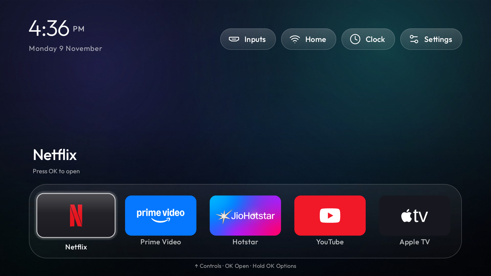

# BRAVIA TV Launcher

A custom Android TV launcher for Sony BRAVIA and Google TV, with a tvOS-inspired five-app dock, Liquid Glass-inspired focus motion, and a StandBy-style clock screensaver. Navigate with a D-pad or phone remote. The interface uses Inter typography, icon-only controls, and a procedural wallpaper.



*Captured on a Sony BRAVIA VU3 with the earlier on-device build.*

[Build from source](#build-from-source) · [Device setup](#device-setup) · [Good first issues](https://github.com/andy1924/bravia-tv-launcher/contribute)

## Compatibility

| Device | Android | Verification |
| --- | --- | --- |
| Sony BRAVIA VU3 | 14 | Earlier build verified on TV for Home navigation, restart, and clock. The redesigned focus animation and icon-only controls passed local build checks and await TV testing. |
| Other Sony BRAVIA, Android TV, and Google TV devices | Varies | Device reports welcome. The included Home setup targets the VU3. |

## Build from source

Install JDK 21 and the Android SDK packages `platforms;android-34` and `build-tools;34.0.0`. Point `JAVA_HOME` and `ANDROID_HOME` at those installations, then run:

```sh
./build.sh
```

The build runs unit tests and Android lint and produces `launcher/app/build/outputs/apk/release/app-release.apk`. The first build downloads Gradle dependencies.

Open [the local design preview](design/preview.html) in a browser after cloning. It illustrates focus movement and the clock. See [design notes](design/DESIGN.md) for the Apple design references.

## Device setup

For the Sony VU3 setup, install Android platform-tools, create the Python environment below, and point `TV_HOST` at your authorized debugging connection. Set `TV_ADB_BINARY` to the path of your `adb` executable.

```sh
python3 -m venv tools/venv
tools/venv/bin/python -m pip install -r tools/requirements.txt
```

`install.py` installs the APK, applies the theme, and configures the Sony-specific Home redirect and clock screensaver. It grants the launcher's helper access to secure settings and enables its accessibility service. Review the script before using it on a device. Google TV's Home screen may appear briefly during handover.

The theme in `theme/config.json` controls dock order, visible apps, and focus settings. Device recovery snapshots are local to each installation.

To go back to the stock Google TV Home screen, see [Return to the stock Home screen](#return-to-the-stock-home-screen).

## Return to the stock Home screen

These steps come from reading `install.py`, `restore-google-tv.sh`, `restore-previous.py` and `restore-unwanted.py`. They have not been verified on a TV; the steps marked **needs a TV** are the ones to confirm and report.

**Before you start:** turn on wireless debugging on the TV, set `TV_HOST` to its current `IP:port` (it changes), and set `TV_ADB_BINARY` to your `adb` if it is not at `.local/android-sdk/platform-tools/adb`.

### Back to Google TV Home

```sh
TV_HOST=192.0.2.10:5555 ./restore-google-tv.sh
```

`restore-google-tv.sh` undoes what `install.py` set up. It:

1. re-enables `com.google.android.apps.tv.launcherx`, the Google TV launcher;
2. clears the enabled accessibility services and turns accessibility off, which removes the launcher's helper;
3. sets Google TV's `HomeActivity` as the Home app again;
4. disables the launcher, `com.gathin.tvhome`, with `pm disable-user` (it stays installed);
5. sends the Home key.

It clears **every** enabled accessibility service, not only the launcher's helper, so turn back on any other you use in the TV's settings. It does not touch the screensaver: `install.py` pointed it at this launcher's clock, so choose another screen saver in the TV's settings after the restore (**needs a TV**).

### Back to the previous launcher build

`restore-previous.py` goes to an earlier build of this launcher, not to stock Home. It needs the local snapshots `backups/previous-launcher.apk`, `backups/tv-settings-before-custom.json` and `backups/previous-theme`, which are not in the repository because each installation keeps its own. It installs that APK, restores the saved secure settings, reapplies the previous theme and starts the launcher. If the install does not report `Success`, it stops and leaves the settings alone.

### Re-enable apps you disabled

`restore-unwanted.py` re-enables the entertainment apps that were disabled and recorded in `backups/original-tv/unwanted-apps-recovery.json`. It leaves Home and system services alone, so it does not change which launcher is used.

### Check that stock Home works

1. Press the Home button on the remote. Google TV Home should open, not the dock (**needs a TV**).
2. Restart the TV and press Home again, to confirm the setting survives a restart (**needs a TV**).
3. Leave the TV idle and check which screen saver starts (**needs a TV**).

If Home still opens this launcher, run the restore again with a fresh `TV_HOST`: the debugging port changes whenever wireless debugging is toggled.

## Contribute

Start with [the contribution guide](CONTRIBUTING.md). Documentation, offline tooling, and device compatibility reports are welcome.

See [LICENSE](LICENSE) for the source license. Icon and font notices are bundled with the project.
